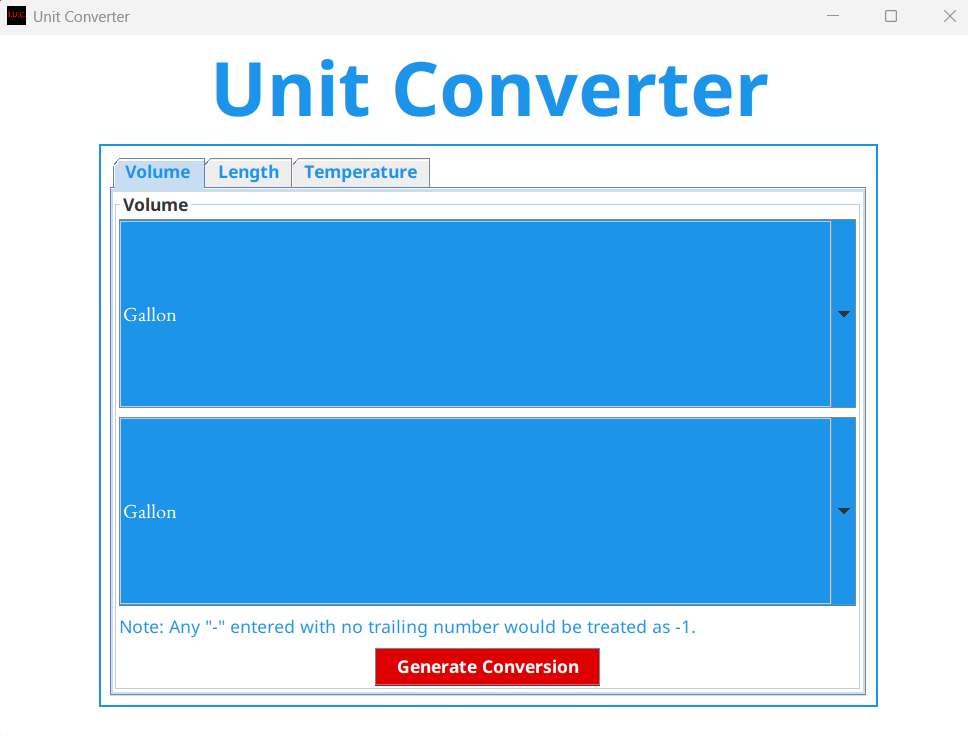
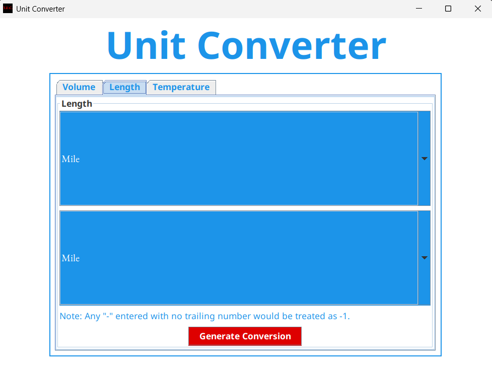
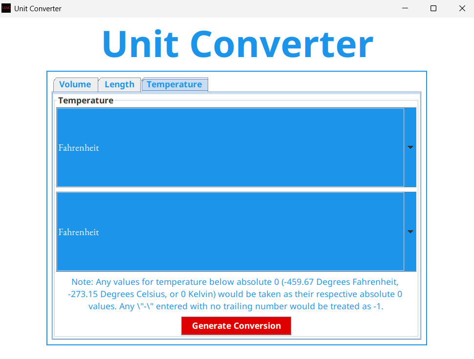
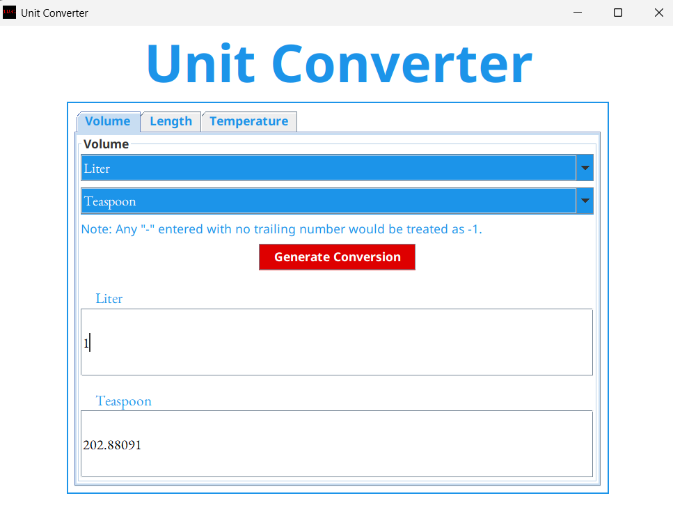
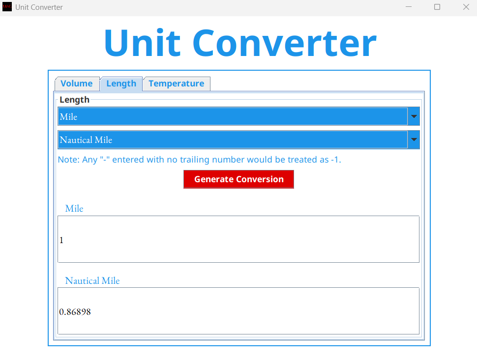
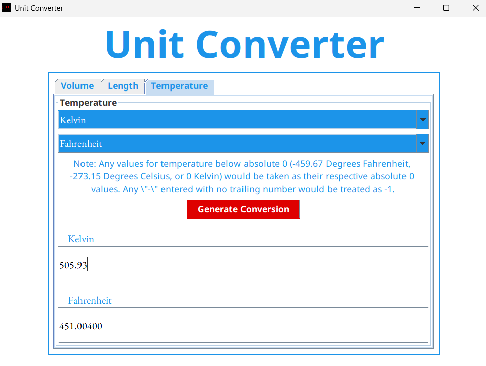

<div align="center">

# Java Unit Converter

A Java Swing desktop application for volume, length, and temperature conversion with real-time bidirectional calculation and a tab-based user interface.


</div>

---

## Overview

Java Unit Converter is a lightweight desktop tool built with pure Java Swing. It converts between common units of measurement in real time with no external dependencies.

- Real-time bidirectional conversion
- Tab-based user interface
- Custom open-source typography
- Zero external libraries or frameworks

---

## Demo & Interface

<p align="center">
  
  
  
</p>

<p align="center">
  
  
  
</p>

---

## Features

### Volume Conversion
Convert between 13 volume units:
- Gallons, Quarts, Pints
- U.S. Cups, Tablespoons, Teaspoons
- Cubic Inches, Feet, Yards
- Liters, Milliliters
- Cubic Meters, Cubic Centimeters

### Length Conversion
Convert between 8 length units:
- Miles, Yards, Feet, Inches
- Meters, Kilometers, Centimeters
- Nautical Miles

### Temperature Conversion
Convert between 3 temperature scales:
- Fahrenheit
- Celsius
- Kelvin

---

## How It Works

1. **Select a conversion category** -- choose Volume, Length, or Temperature using the tabs.

2. **Generate a conversion box** -- select a source unit and a target unit, then click Generate Conversion. Identical unit selections are blocked with a clear error message.

3. **Convert in real time** -- enter a value in either field. The converted value updates instantly. The input supports decimals and negative numbers. Entering `-` alone is treated as `-1` for convenience.

---

## Installation & Running

### Requirements
- Java Development Kit (JDK) 8 or later
- No external dependencies

### Project Structure
```
Java-unit-converter/
  pom.xml                          Maven build file
  launch.bat                       Quick launcher (no Maven required)
  src/
    main/
      java/
        com/unitconverter/
          App.java                 Main application source
      resources/
        fonts/
          NotoSans-Regular.ttf
          NotoSans-Bold.ttf
          EBGaramond-Regular.ttf
        favicon.png
  font_licenses/
    OFL-Noto_Sans.txt
    OFL-EB_Garamond.txt
```

### Compile & Run

**Quick start (no Maven required):**
```
.\launch.bat
```

**With Maven (build only):**
```
mvn clean package
```

**With Maven (compile and run):**
```
mvn clean compile exec:java -Dexec.mainClass="com.unitconverter.App"
```

**Without Maven (manual):**
```
mkdir target\classes
dir /b /s src\main\java\*.java > sources.txt
javac -d target\classes -encoding UTF-8 @sources.txt
xcopy /e /y src\main\resources target\classes\
java -cp target\classes com.unitconverter.App
```

---

## Troubleshooting

**Fonts not loading**
- Verify that `src/main/resources/fonts/` exists and filenames match those referenced in `App.java`.
- Check file read permissions, especially on Linux and macOS.

**Classpath errors**
```
javac -d target\classes -encoding UTF-8 src\main\java\com\unitconverter\App.java
xcopy /e /y src\main\resources target\classes\
java -cp target\classes com.unitconverter.App
```

**UI looks incorrect**
- Inspect the console for font loading errors.
- Confirm font paths are correct.

---

## Font Attribution

This project uses fonts licensed under the SIL Open Font License (OFL).

### EB Garamond
- Author: Georg Duffner
- Source: https://github.com/octaviopardo/EBGaramond12
- License: `font_licenses/OFL-EB_Garamond.txt`

### Noto Sans
- Author: Google Inc.
- Source: https://github.com/notofonts/latin-greek-cyrillic
- License: `font_licenses/OFL-Noto_Sans.txt`

---

## License Compliance

This project complies with the Apache License 2.0 and the SIL Open Font License by:
1. Including unmodified font files
2. Bundling full license texts
3. Preserving copyright notices
4. Refraining from redistributing fonts independently
5. Providing clear attribution

---

## Contributing

Contributions, bug reports, and suggestions are welcome. Please read `CONTRIBUTING.md` before submitting a pull request.

---

&copy; 2025-2026 richie-rich90454
